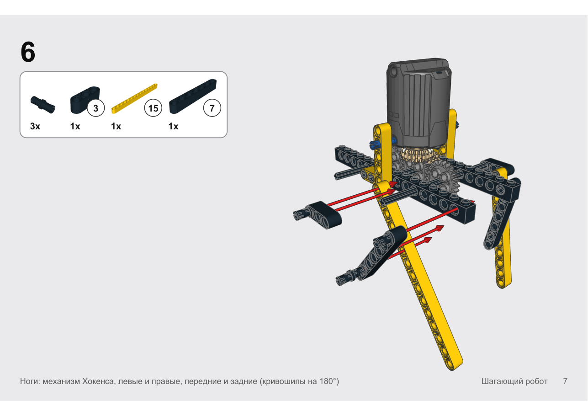

# TechnicLab

**Lego Technic models written in Python. Laws check that every part holds, every pin sits in two parts and
every motor has power; then the code renders step-by-step PDF instructions for an iPad mini and for A4.**

[Русский](README.ru.md)

    

Code, tests and docs were written by Claude (Anthropic) in Claude Code; ideas, review and decisions are Alexey's.

Every model uses only parts from one real Technic collection (`ядро/inventory.py`). This is a fan project: LEGO is a
trademark of the LEGO Group, which does not sponsor or endorse it.

## Models

| | Model | Parts | Pages | Build time |
| --- | --- | --- | --- | --- |
|  | **Buggy** - 4x4, steering from the axle, open V8, winch and spare wheel | 285 | 76 | ~2 h 30 min |
|  | **Dump truck 6x6** - six wheels, a hinged bed with sides, V8 and steering | 372 | 98 | ~3 h 00 min |
|  | **Racer** - low tyres, streamlined hood, rear drive with a step-up gear pair | 229 | 59 | ~2 h 00 min |
|  | **Robot arm** - shoulder on a linear actuator with an M motor, gripper on an L motor | 44 | 15 | ~15 min |
|  | **Walker** - four legs on Hoekens linkages driven by one XL motor | 80 | 19 | ~45 min |
|  | **Pendulum clock** - a falling weight, an escapement and a pendulum, minute hand | 28 | 11 | ~15 min |

Total: 1038 parts in 6 models. Build time assumes about 2 parts a minute.

## Instructions

`python ядро/instructions.py` builds two PDFs per model into its folder:
- **iPad mini** - one page is exactly the iPad mini 7 screen in full-screen view, so the 1:1 pages at the end
  show axles and beams at their real length;
- **A4** (landscape) - the same pages 1.68 times larger for print; the 1:1 pages stay 1:1 (print at 100 %).

Like LEGO instructions: a list of parts for each step, new parts float next to their place with red arrows,
sub-assemblies in a frame, a rotate sign when the view turns, all parts and wiring at the end.

## Run

Needs Python 3.11+, `pip install pillow numpy reportlab pypdf pymupdf pytest`, the LDraw library
(`LDRAWDIR`), the LDCad shadow library with connection points (`LDCAD_SHADOW`) and LDView for pictures.

| What | Command |
| --- | --- |
| All laws of all models | `python -m pytest -q ядро/test_laws.py` |
| Laws of one model | `python рука/arm.py` (the same for the other folders) |
| Instructions (all or one model) | `python ядро/instructions.py [багги]` |

## Inside

- `ядро/` - parts and connections (`ldr.py`, `snaps.py`), the collection (`inventory.py`), the laws and the buggy
  base (`car.py`, `body.py`), pictures (`render.py`), instructions (`instructions.py`), tests (`test_laws.py`).
- one folder per model - its script, pictures and `.ldr` file (opens in LDCad, LeoCAD, Studio).
- `архив/` - earlier versions and sketches.

## License

[MIT](LICENSE)
