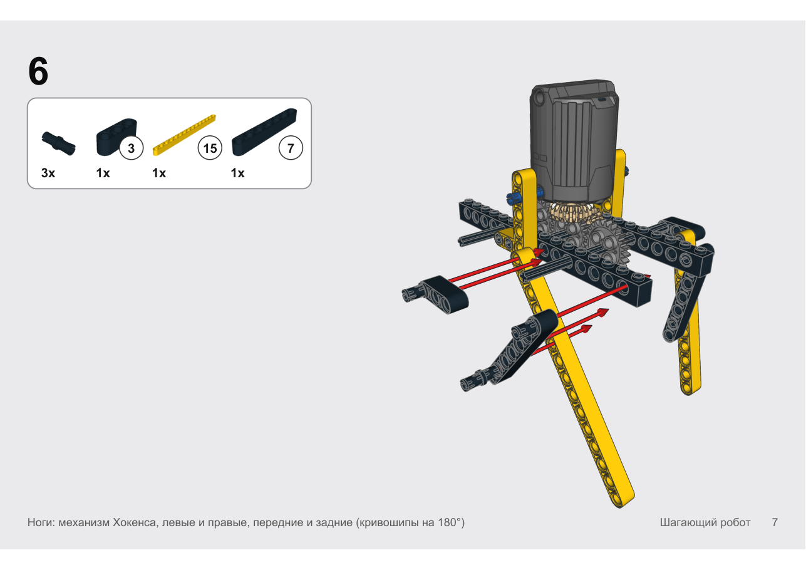

# TechnicLab

**Модели Lego Technic, написанные на Python. Законы проверяют, что каждая деталь держится, каждый штифт сидит
в двух деталях и у каждого мотора есть питание; потом код рисует пошаговые инструкции PDF для iPad mini и A4.**

[English](README.md)

     

Код, тесты и документацию написал Claude (Anthropic) в Claude Code; идеи, проверка и решения - Алексея.

Все модели собраны только из деталей одного настоящего набора Technic (`ядро/inventory.py`). Фанатский проект:
LEGO - товарный знак LEGO Group, она его не спонсирует и не одобряет.

## Модели

| | Модель | Деталей | Страниц | Сборка |
| --- | --- | --- | --- | --- |
|  | **Багги** - полный привод, руль от моста, открытый V8, лебёдка и запаска | 285 | 76 | ~2 ч 30 мин |
|  | **Самосвал 6x6** - шесть колёс, кузов с бортами на петле, V8 и руль | 372 | 98 | ~3 ч 00 мин |
|  | **Гоночная** - низкие шины, обтекаемый капот, задний привод с повышающей парой | 229 | 59 | ~2 ч 00 мин |
|  | **Механическая рука** - плечо на актуаторе с мотором M, захват на моторе L, блок - противовес | 44 | 15 | ~15 мин |
|  | **Шагающий робот** - четыре ноги на механизме Хокенса, мотор XL сверху | 80 | 19 | ~45 мин |
|  | **Маятниковые часы** - гиря на верёвке, анкер и маятник, минутная стрелка | 28 | 11 | ~15 мин |

Всего 1038 деталей в 6 моделях. Время сборки - примерно 2 детали в минуту.

## Инструкции

Готовые PDF (12 файлов, шесть моделей в двух размерах) - в [Releases](https://github.com/ALEXalesha/TechnicLab/releases/latest).

`python ядро/instructions.py` кладёт в папку каждой модели два PDF:
- **iPad mini** - страница ровно равна экрану iPad mini 7 во весь экран, поэтому листы 1:1 в конце показывают
  оси и балки в натуральную длину;
- **A4** (альбомный) - те же страницы в 1,68 раза крупнее для печати; листы 1:1 остаются 1:1 (печать 100 %).

Как у LEGO: список деталей на каждом шаге, новые детали «подлетают» к месту с красными стрелками, узлы в рамке,
значок поворота при смене вида, в конце все детали и провода.

## Запуск

Нужны Python 3.11+, `pip install pillow numpy reportlab pypdf pymupdf pytest`, библиотека LDraw
(`LDRAWDIR`), теневая библиотека LDCad с точками соединения (`LDCAD_SHADOW`) и LDView для картинок.

| Что | Команда |
| --- | --- |
| Законы всех моделей | `python -m pytest -q ядро/test_laws.py` |
| Законы одной модели | `python рука/arm.py` (так же в остальных папках) |
| Инструкции (все или одна модель) | `python ядро/instructions.py [багги]` |

## Внутри

- `ядро/` - детали и сцепления (`ldr.py`, `snaps.py`), набор (`inventory.py`), законы и база багги (`car.py`,
  `body.py`), картинки (`render.py`), инструкции (`instructions.py`), тесты (`test_laws.py`).
- папка на модель - её скрипт, картинки и файл `.ldr` (открывается в LDCad, LeoCAD, Studio).
- `архив/` - прошлые версии и эскизы. Журнал решений - `СХЕМА.md`.

## Лицензия

[MIT](LICENSE)
